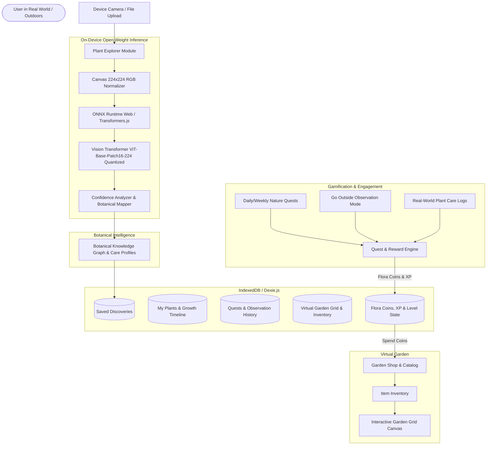
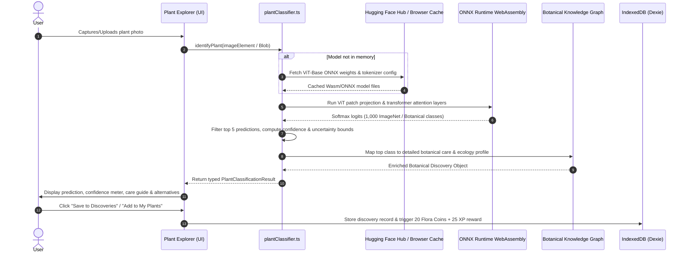
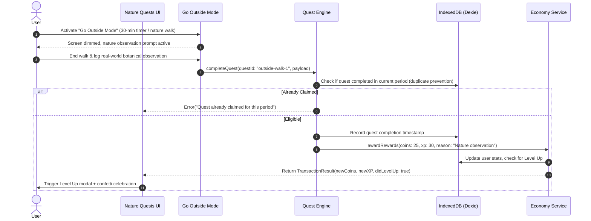

# My Garden World — System Architecture

## 1. High-Level Architecture Overview

**My Garden World** is an open-source, local-first botanical companion built for the Hacktoberfest Open-Source AI Challenge (Week 1: *Touch Grass*). It unites genuine on-device computer vision inference with plant care journaling and an interactive virtual garden economy.

---

## 2. Module Responsibilities

| Module | Responsibility | Key Dependencies |
| :--- | :--- | :--- |
| **`src/ai/plantClassifier.ts`** | Stable boundary for open-weight model loading, preprocessing, inference execution, and honest confidence scoring. | `@xenova/transformers`, `onnxruntime-web` |
| **`src/ai/botanicalDatabase.ts`** | Curated botanical database with taxonomy, sunlight, hydration, soil, propagation, and eco-facts. | None (Pure TS domain model) |
| **`src/db/index.ts`** | Local-first persistence layer managing plants, dated growth photos, quests, garden items, and transaction logs. | `dexie` (IndexedDB) |
| **`src/services/questEngine.ts`** | Validates quest criteria, computes XP/Flora Coins, prevents duplicate claims, and handles "Go Outside" observations. | `dexie` |
| **`src/services/economyService.ts`** | Manages coin balances, level progression curves, shop purchases, and inventory allocations. | `dexie` |
| **`src/components/garden/*`** | Interactive 2.5D virtual garden grid allowing drag-and-drop placement, rotation, and persistence of plants, pots, and decorations. | `framer-motion`, `lucide-react` |
| **`src/components/plants/*`** | Plant growth journal, before/after visual timeline comparisons, and care history trackers. | `lucide-react` |

---

## 3. Plant-Identification Data Flow

---

## 4. Quest-to-Reward Transaction Flow

---

## 5. Persistence Strategy & Offline Architecture

- **Local-First Reliability**: All user data (plant records, dated growth photos in base64/blob storage, nature logs, garden layout, coins) is stored locally in IndexedDB using Dexie.js.
- **Offline Model Caching**: ONNX model files are cached using the browser's CacheStorage API (`env.useBrowserCache = true`). Once fetched initially, inference works fully offline without internet access.
- **Service Worker & Manifest**: PWA shell caching enables the complete web application to open and run offline in outdoor settings with zero connectivity.

---

## 6. Privacy & Security Decisions

1. **Zero External Vision Uploads**: Plant photos are processed **100% on the user's device** inside WebAssembly. No photos are sent to proprietary vision APIs or remote third parties.
2. **Optional Location Privacy**: Location coordinates are not collected or transmitted. Nature observation timestamps and user notes remain strictly in client-side IndexedDB.
3. **Data Ownership**: Users have a one-click "Export Garden Data (JSON)" and "Clear All Data" control in Settings.
4. **Honest Economy**: The in-game currency (*Flora Coins*) is clearly communicated as a local gamified progression mechanic, not a real-world cryptocurrency.
