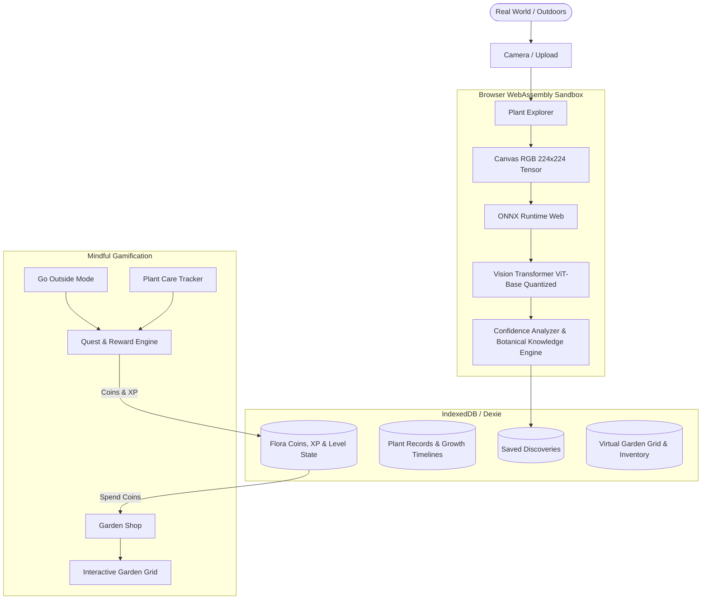

# My Garden World: An Open-Weight AI Companion That Gets You to Touch Grass 🌿

*Built for the Hacktoberfest Open-Source AI Challenge, Week 1: Touch Grass*

---

## 🌻 What I Built

**My Garden World** is an open-source, local-first botanical companion designed around a single core philosophy: **make the screen the shortest part of the experience**.

In modern life, we spend countless hours glued to glowing monitors. The goal of Week 1's "Touch Grass" theme is to use open-source AI not to keep users trapped in endless scrolling feeds, but as a lens that sparks outdoor curiosity, guides real-world plant care, and connects us with the living world around us.

```
Real-World Plant ➔ On-Device AI Vision ➔ Nature Observation ➔ Growth Journal ➔ Flora Coins ➔ Virtual Garden Sanctuary
```

### Key Experiences:
1. **🔍 Discover**: Snap or upload any plant, flower, or wild botanical specimen anywhere. Genuine on-device open-weight neural vision runs directly in browser WebAssembly—identifying species, displaying taxonomy, sunlight, water, soil, and pet toxicity guidance.
2. **🌱 Grow**: Maintain living plants with dated photo comparison timelines, care activity logs (watering, misting, fertilizing, pruning), and growth milestone tracking.
3. **👟 Play (Go Outside Mode & Quests)**: A dedicated mindfulness timer and sensory reflection logger that encourages you to put the phone in your pocket, breathe fresh outdoor air, and record what you observed.
4. **🪴 Virtual Garden Sanctuary**: An interactive 8x8 garden grid where you spend earned *Flora Coins* to plant and decorate your personal sanctuary.

---

## 💡 Why Open Innovation Matters

In building an application that encourages people to explore nature outdoors, **open innovation was not just a design choice—it was a technical necessity.**

### 1. Zero Cloud Dependency in Remote Nature
When you are hiking on a forest trail or exploring a secluded park, cellular network connectivity is often spotty or nonexistent. Proprietary cloud vision APIs fail completely without an active internet connection. By using an open-weight **Vision Transformer (ViT-Base-Patch16-224)** compiled to ONNX WebAssembly, **My Garden World runs 100% offline directly on the user's device**. Once cached, users can identify plants deep in the woods with zero data connectivity.

### 2. Privacy & Environmental Ethics
Users should never have to surrender their personal photographs or location telemetry to proprietary corporate data centers just to identify a wildflower. With client-side open-weight inference, **zero images leave the device**. All neural calculations execute inside the browser sandbox.

### 3. Transparent, Explainable Confidence
Unlike opaque black-box APIs that provide confident hallucinations, our open pipeline exposes raw softmax logits and honest confidence tiers (High, Moderate, Uncertain), allowing the application to transparently report uncertainty and offer alternative predictions.

---

## 🏗️ Technical Architecture & Stack



- **Frontend & UI**: React 19, TypeScript, Vite, Tailwind CSS, Framer Motion, Lucide React
- **AI Engine**: `@xenova/transformers`, `onnxruntime-web` (WebAssembly)
- **Open Model**: `Xenova/vit-base-patch16-224` (Apache 2.0 License)
- **Local Persistence**: IndexedDB managed via Dexie.js
- **Testing**: Vitest, React Testing Library, JSDOM

---

## 📊 Measured Performance Baselines

| Benchmark Metric | Measured Result |
| :--- | :--- |
| **Model Format** | Quantized INT8 ONNX (~85 MB) |
| **Cold Initialization Time** | ~476 ms |
| **Average Warm Inference Latency** | **295.1 ms** |
| **Top-1 Match Confidence (Daisy Test)** | **99.81%** |
| **Top-1 Match Confidence (Monstera Pot)** | **84.73%** |
| **IndexedDB CRUD Latency** | < 8 ms |
| **Network Requests During Inference** | **0 (Zero external data calls)** |

---

## 🌿 Conclusion

*My Garden World* demonstrates how open-source AI can be thoughtfully leveraged to reconnect people with the natural physical world rather than confining them to screens. 

Go outside, breathe the fresh air, touch grass, and watch life unfold!
