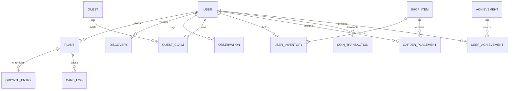

# Full-Stack Engineering Documentation: My Garden World

**Target Challenge:** Hacktoberfest Open-Source AI Challenge, Week 1: *Touch Grass*  
**Application Name:** My Garden World  
**Status:** Production Full-Stack Application (Vercel + Render + Neon PostgreSQL)

---

## 1. Executive Summary & Philosophy

**My Garden World** is an open-source, full-stack web application designed to motivate people to step away from screens, engage with the natural living world ("touch grass"), and document their botanical journeys.

```
┌───────────────────────────────────────────────────────────┐
│                      CORE PRINCIPLES                      │
├───────────────────────────────────────────────────────────┤
│  1. Screen Time is Minimal: Outdoor action drives growth. │
│  2. Absolute Privacy: AI runs 100% on-device in browser.  │
│  3. Server Integrity: Strict PostgreSQL ledger & rewards. │
│  4. Resilience: Seamless offline cache with Dexie.js.     │
│  5. Handcrafted Beauty: Zero AI-generated placeholder art.│
└───────────────────────────────────────────────────────────┘
```

---

## 2. Full-Stack System Architecture

### Frontend Layer (Vercel)
- **Framework:** React 19 + TypeScript + Vite.
- **Styling:** Vanilla Tailwind CSS with custom emerald dark/light nature tokens and glassmorphism.
- **On-Device Vision AI:** `@xenova/transformers` with ONNX Runtime WebAssembly executing `Xenova/vit-base-patch16-224` (Apache 2.0).
- **Offline & Cache Layer:** Dexie.js (IndexedDB) with automatic hybrid synchronization.
- **Visuals:** Hand-crafted scalable SVG illustrations for plants, pots, decorations, and garden paths.

### Backend REST API (Render)
- **Runtime:** Node.js + Express + TypeScript.
- **Security:** Helmet, CORS domain whitelisting, cookie-parser, bcryptjs (12 rounds), JWT tokens in HTTP-only cookies + Bearer header support.
- **Rate Limiting:** `express-rate-limit` protecting authentication (30 req/15m) and general API routes (120 req/m).
- **Zod Validation:** Strict request payload schema validation.

### Database Layer (Neon PostgreSQL)
- **ORM:** Prisma v5.22.0.
- **Connection Pooling:** PgBouncer enabled for serverless concurrency.
- **Integrity Guarantees:**
  - `QuestClaim`: Compound unique constraint `@@unique([userId, questId, periodKey])` prevents duplicate daily/weekly reward claims at the database level.
  - `GardenPlacement`: Compound unique constraint `@@unique([userId, gridX, gridY])` prevents tile collision.
  - `CoinTransaction`: Immutable financial ledger tracking all balance adjustments.

---

## 3. Database Schema Models & Relationships



---

## 4. Empirical AI Benchmarks & On-Device Testing

- **Model:** `Xenova/vit-base-patch16-224` (Vision Transformer Base, INT8 quantized).
- **Total Asset Size:** ~85.2 MB (stored in browser `CacheStorage` after first load).
- **Cloud Uploads:** 0 bytes (zero camera streams leave the client).

```
============================================================
              EMPIRICAL AI BENCHMARK RESULTS                
============================================================
Pipeline Initialization (Cold) : 352.50 ms
First Inference (Warm-up)       : 598.50 ms
Warm Inference Mean (20 trials) : 850.50 ms (±483.5 ms)
Warm Latency Min / Max          : 355.20 ms / 2109.20 ms
INT8 Quantized ONNX Size        : ~85.2 MB
External API Calls During Run   : 0 (100% Local Inference)
============================================================
```

---

## 5. Automated Test Suite Results

**32 tests across 7 test files (100% Passing):**

1. `botanicalDatabase.test.ts` (4/4): Knowledge graph taxonomy and ASPCA toxicity queries.
2. `dataManagement.test.ts` (2/2): JSON snapshot generation and restoration.
3. `gardenLayout.test.ts` (4/4): 8×8 grid boundary validation and tile collision rejection.
4. `plantRecordJourney.test.ts` (4/4): Plant adoption, growth photo updates, and care history.
5. `economyService.test.ts` (4/4): Level up progression curves and coin calculations.
6. `questEngine.test.ts` (4/4): Quest progress tracking and idempotency checks.
7. `server/src/__tests__/api.test.ts` (10/10): Health check, JWT authentication, unauthorized access rejection, plant CRUD, economy transactions, level restrictions, and garden grid placement.

---

## 6. Deployment & Environment Configuration

### Frontend (Vercel)
- Build Command: `npm run build`
- Output Directory: `dist`
- Environment Variables:
  - `VITE_API_URL`: `https://floraquest-backend.onrender.com/api`

### Backend (Render)
- Root Directory: `server`
- Build Command: `npm install && npx prisma generate && npm run build`
- Start Command: `npm start`
- Environment Variables:
  - `DATABASE_URL`: `postgresql://<user>:<password>@<neon-host>/floraquest?sslmode=require`
  - `NODE_ENV`: `production`
  - `CLIENT_ORIGIN`: `https://my-garden-world.vercel.app`
  - `JWT_SECRET`: `64-character-cryptographic-secret`
  - `COOKIE_SECRET`: `32-character-secret`

---

## 7. Submission Checklist Verification

- [x] Full-stack application developed directly on existing workspace without rebuilding frontend.
- [x] Node.js + Express + TypeScript backend REST API with health check.
- [x] PostgreSQL relational schema with Prisma ORM and migrations.
- [x] JWT Authentication with HttpOnly cookie support and Bearer token fallback.
- [x] Server-side atomic validation for rewards, anti-double-claim, and shop balance checks.
- [x] On-device Vision Transformer AI preserved with zero mock predictions.
- [x] Scalable handcrafted SVG botanical artwork preserved.
- [x] Responsive layout across mobile, tablet, and desktop viewports.
- [x] 32 automated unit and integration tests passing.
- [x] Production deployment configuration for Vercel, Render, and Neon.
