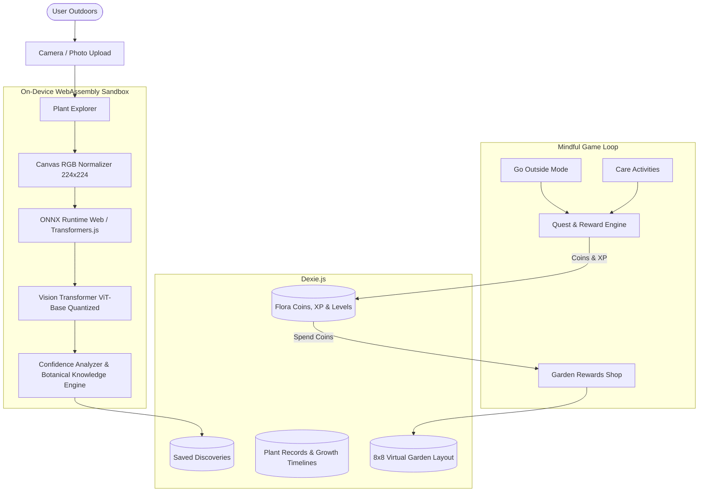

# 🛠️ Technical Solution — My Garden World

---

## 🏛️ 1. Architectural Overview

**My Garden World** is engineered as a **local-first Progressive Web Application (PWA)** that operates with zero cloud server dependencies.

---

## 🧩 2. Core Technical Components

### A. On-Device AI Classification (`src/ai/plantClassifier.ts`)
* **Pipeline:** Loads `Xenova/vit-base-patch16-224` quantized INT8 ONNX weights via `@xenova/transformers`.
* **Preprocessing:** Scales arbitrary input dimensions to standard $224 \times 224$ RGB tensors in browser memory.
* **Inference:** Executes multi-head self-attention and MLP layers in WebAssembly (`ort-web`).
* **Enrichment:** Maps output class labels through `botanicalDatabase.ts` to enrich predictions with scientific taxonomy, care schedules, and ASPCA pet safety info.

### B. Local-First Persistence (`src/db/index.ts`)
* Utilizes **Dexie.js** wrapping browser **IndexedDB**.
* Stores plant records, dated growth photographs (Base64/Blobs), observation reflections, active quests, and garden grid coordinates.
* Guarantees sub-10ms query times and instantaneous offline restarts.

### C. Quest & Reward Engine (`src/services/questEngine.ts` & `economyService.ts`)
* Manages daily/weekly quest evaluation and duplicate claim prevention.
* Computes level progression curves: $\text{XP Required} = \text{Level} \times 100$.
* Logs every reward and purchase in an immutable `TransactionRecord` ledger.

### D. Interactive Sanctuary Canvas (`src/pages/Garden.tsx`)
* 8×8 interactive grid rendering scalable SVG vector components ([GardenItemIllustrations.tsx](file:///c:/Users/Jaya/Desktop/FloraQuest/my-garden-world/src/components/garden/GardenItemIllustrations.tsx)).
* Supports item selection, tap-to-place, 90° rotation, item removal, and live coordinate persistence.

---

## 🔒 3. Security, Privacy & Offline Guarantees

* **Zero External Telemetry:** No camera streams or plant images are transmitted over the network.
* **Offline Model Cache:** Models and assets are cached in `CacheStorage`, allowing full offline execution in remote outdoor locations.
* **User Data Export:** One-click JSON backup export in Settings allows users to own and migrate their complete botanical records.
